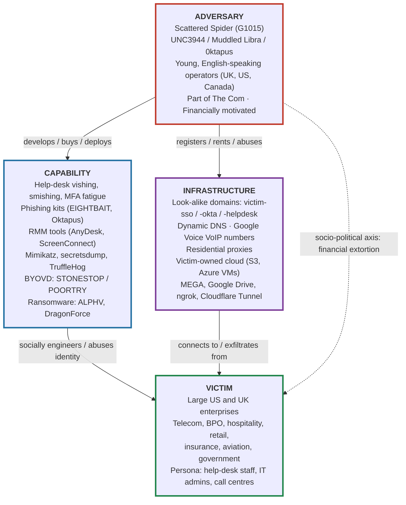

# Threat Actor Profile: Scattered Spider (G1015)

> Structured intelligence assessment built from public vendor reporting (Mandiant, Unit 42, FS-ISAC) and MITRE ATT&CK.
> **Evidenced facts** come with a source tag. **Analyst inference** is labelled as such.

| Field | Detail |
| --- | --- |
| **MITRE ATT&CK ID** | [G1015](https://attack.mitre.org/groups/G1015/) |
| **Aliases** | Muddled Libra (Unit 42), UNC3944 (Mandiant), 0ktapus / Roasted 0ktapus, Scatter Swine, Octo Tempest, Storm-0875 |
| **Active since** | 2022 (FS-ISAC). Mandiant tracks phishing-kit activity from late 2021 |
| **Motivation** | Financial: data theft, extortion, ransomware affiliate work |
| **Operator profile** | Young, English-speaking, Western-based (UK, US, Canada); part of the wider "The Com" online community |

Source key: **M** = Mandiant (2023) · **U42** = Unit 42 (2025) · **FS** = FS-ISAC (2025) · **ATT&CK** = MITRE G1015 entry

---

## 1. Executive Summary

Scattered Spider is a financially motivated, English-speaking cybercriminal collective active since 2022. It gets in by talking its way in: it phones IT help desks posing as employees, has their passwords and MFA reset, then uses legitimate admin, identity and cloud tools to reach domain or cloud admin, sometimes within an hour. It makes money through data-theft extortion and as an affiliate of ransomware programmes (ALPHV, DragonForce), and it works through one sector at a time. It matters because its methods get around technical controls by exploiting help-desk processes, so organisations with large or outsourced help desks are most exposed.

---

## 2. Background

Scattered Spider relies on social engineering, not bespoke malware, and favours legitimate software and tools already present in the victim's environment.

| Period | Focus | Source |
| --- | --- | --- |
| 2022 – early 2023 | Smishing and credential theft against telecom and BPO firms, partly to enable SIM swapping. Twilio breach (2022) | M, FS |
| Mid-2023 – 2024 | Enterprise compromise, cloud/SaaS persistence, data-theft extortion, ALPHV ransomware. MGM Resorts and Caesars (2023) | M, FS |
| 2025 | Help-desk vishing, privilege escalation within hours, hypervisor targeting, DragonForce partnership. Sector waves: government → retail → insurance → aviation | U42, FS |

**Law enforcement:** disruption operations in mid-to-late 2024; five suspected members charged in November 2024; four people later arrested over attacks on UK retailers. Activity continued through 2025 (U42).

---

## 3. TTPs & ATT&CK Mapping

✓ = technique listed on MITRE's G1015 entry (ATT&CK v19). Rows without ✓ are my own mapping from the vendor description.

| Phase | TTP | Technique ID | Technique name | ✓ | Source |
| --- | --- | --- | --- | --- | --- |
| Reconnaissance | Gathering employee PII (usernames, employee IDs) for impersonation | T1589 | Gather Victim Identity Information | ✓ | M |
| Resource development | Registering look-alike SSO / help-desk domains | T1583.001 | Acquire Infrastructure: Domains | ✓ | M, FS |
| Resource development | Buying infostealers, RATs and ransomware | T1588.001 | Obtain Capabilities: Malware | ✓ | M, FS |
| Initial access | Smishing links to credential-harvesting pages | T1598.003 | Phishing for Information: Spearphishing Link | ✓ | M, FS |
| Initial access | Calling help desks as an employee to reset password/MFA | T1598.004 / T1684.001 | Spearphishing Voice / Social Engineering: Impersonation | ✓ | U42, FS, M |
| Initial access | Calling users as "IT" so that they install RMM tools | T1566.004 / T1204 | Phishing: Spearphishing Voice / User Execution | ✓ | U42 |
| Initial access | MFA fatigue (push bombing) | T1621 | Multi-Factor Authentication Request Generation | ✓ | FS |
| Initial access | SIM swapping to intercept one-time codes | T1451 (Mobile) | SIM Card Swap | ✓ | M |
| Initial access | Logging in with stolen or reset credentials | T1078 / T1078.004 | Valid Accounts / Cloud Accounts | ✓ | M, U42 |
| Credential access | Dumping NTDS.dit | T1003.003 | OS Credential Dumping: NTDS | ✓ | U42, FS |
| Credential access | Dumping LSASS (Mimikatz) | T1003.001 | OS Credential Dumping: LSASS Memory | | FS |
| Credential access | Extracting secrets from HashiCorp Vault / CyberArk | T1555.005 | Credentials from Password Stores: Password Managers | ✓ | M, U42 |
| Credential access | Scanning internal GitHub for secrets (TruffleHog) | T1213.003 / T1552.001 | Code Repositories / Credentials in Files | ✓ | M |
| Privilege escalation | Assigning admin roles in Azure / abusing permissive identities | T1098.003 | Account Manipulation: Additional Cloud Roles | ✓ | M, U42 |
| Privilege escalation | BYOVD (STONESTOP, POORTRY) to kill EDR | T1068 | Exploitation for Privilege Escalation | ✓ | FS |
| Persistence | Registering attacker MFA devices | T1098.005 / T1556.006 | Device Registration / Modify Auth Process: MFA | ✓ | FS |
| Persistence | Rogue federated IdP in Entra ID (Golden SAML) | T1484.002 / T1606.002 | Trust Modification / Forge Web Credentials: SAML Tokens | ✓ / – | M |
| Persistence | Creating new accounts | T1136 | Create Account | ✓ | FS |
| Persistence | Scheduled tasks and malicious services | T1053.005 / T1543.003 | Scheduled Task / Windows Service | | FS |
| Persistence | Unmonitored Azure VMs / EC2 instances | T1578.002 | Create Cloud Instance | ✓ | M |
| Persistence | RMM tools, VPN and Citrix for re-entry | T1133 / T1219.002 | External Remote Services / Remote Desktop Software | ✓ | U42, FS |
| Defence evasion | Disabling AV/EDR, logging, telemetry; Defender via Intune | T1685 / T1072 | Disable or Modify Tools / Software Deployment Tools | ✓ / – | FS, M |
| Defence evasion | Altering Group Policy | T1484.001 | Group Policy Modification | | FS |
| Defence evasion | Mailbox rules hiding security alerts | T1564.008 | Email Hiding Rules | ✓ | FS |
| Defence evasion | Residential proxies close to the victim's location | T1090 | Proxy | ✓ | M |
| Discovery | AD and Azure enumeration (ADExplorer, ADRecon, MicroBurst) | T1069.002 / T1087.004 | Domain Groups / Cloud Account Discovery | ✓ | M |
| Collection | Searching SharePoint, Slack/Teams and Exchange for credentials and IR notes | T1213.002 / T1213.005 / T1114 | SharePoint / Messaging Applications / Email Collection | ✓ | U42, FS, M |
| Collection | Staging data with 7-Zip / WinRAR | T1560.001 | Archive via Utility | | FS, M |
| Lateral movement | RDP, SSH | T1021.001 / T1021.004 | Remote Desktop Protocol / SSH | ✓ | M, FS |
| Lateral movement | Impacket WMI, PsExec, PowerShell remoting | T1047 / T1569.002 / T1021.006 | WMI / Service Execution / Windows Remote Management | ✓ / – / – | FS, M |
| Lateral movement | Moving through cloud consoles (Azure Serial Console, EC2) | T1021.007 | Cloud Services | ✓ | M |
| Command & control | ngrok, Cloudflare Tunnel, SSH tunnels | T1572 | Protocol Tunneling | ✓ | M, FS |
| Command & control | Pulling tools from GitHub, file.io | T1102 | Web Service | ✓ | FS |
| Exfiltration | Rclone / browser uploads to MEGA, Google Drive | T1567.002 | Exfiltration to Cloud Storage | ✓ | FS, U42 |
| Exfiltration | Azure Data Factory pipelines to attacker-controlled SFTP | T1048 | Exfiltration Over Alternative Protocol | | M |
| Impact | Ransomware (ALPHV, DragonForce), including on ESXi | T1486 | Data Encrypted for Impact | ✓ | M, U42, FS |
| Impact | VM shutdown scripts before encryption | T1529 | System Shutdown/Reboot | | FS |
| Impact | Extortion: leak threats, texting executives | T1657 | Financial Theft | ✓ | M, FS |

> **Mapping note:** ATT&CK v19 retired T1656 (Impersonation) in favour of **T1684.001** and consolidated impair-defence behaviour under **T1685**. Older reports cite the previous IDs.

---

## 4. Kill Chain Mapping

**Campaign:** UNC3944 intrusions leading to ALPHV ransomware, 2022–2023 (Mandiant). Mandiant describes a cluster of intrusions, not one named victim, so each stage reflects the documented pattern.

| Stage | What the group did | ATT&CK | Source |
| --- | --- | --- | --- |
| 1. Reconnaissance | Collected employee PII (usernames, employee IDs) to pass help-desk checks | T1589 | M |
| 2. Weaponization | Built or adapted phishing kits (EIGHTBAIT, cloned login pages); registered `<victim>-sso` / `-servicenow` domains | T1583.001, T1588.001 | M |
| 3. Delivery | SMS phishing to employees; phone calls to help desks posing as staff | T1598.003, T1598.004, T1684.001 | M |
| 4. Exploitation | No software exploit: employees entered credentials and help desks reset passwords/MFA, giving valid accounts | T1078, T1556.006 | M |
| 5. Installation | RMM tools; rogue federated IdP in Entra ID (Golden SAML); unmonitored Azure VMs | T1219.002, T1484.002, T1578.002 | M |
| 6. Command & control | RMM sessions, ngrok / Cloudflare Tunnel, residential proxies | T1219.002, T1572, T1090 | M |
| 7. Actions on objectives | Credentials taken from Vault/CyberArk → data exported via Azure Data Factory → Defender disabled via Intune → ALPHV deployed → extortion | T1555.005, T1048, T1685, T1072, T1486, T1657 | M |

**Gaps:** how victims were selected; C2 domains/IPs (none published); time spent at each stage; how the ALPHV affiliate relationship was arranged.

---

## 5. Infrastructure

> All indicators are **defanged**. No live infrastructure was visited. Observations are dated by report.

### Patterns

| Pattern | Detail | Source (date) |
| --- | --- | --- |
| Domain naming | Victim name + IT/SSO term: `targetsname-sso[.]com`, `-okta[.]com`, `-helpdesk[.]com`, `-servicedesk[.]com`, `-cms[.]com`, `-servicenow[.]com`, `oktalogin-targetcompany[.]com` | M (Sep 2023), FS (2025) |
| DNS | Dynamic DNS providers used with at least five phishing kits since 2023 | FS (2025) |
| Phishing kits | EIGHTBAIT (late 2021 – mid 2022) → cloned login-page kit (Q3 2022) → third kit (mid-2023) | M (Sep 2023) |
| Telephony | >70% of 2025 vishing numbers were Google Voice VoIP | U42 (2025) |
| Anonymity | Commercial residential proxies located near the victim | M (Sep 2023) |
| Living off the victim | Victim's own AWS S3 buckets hosting tools; attacker-built Azure VMs inside the victim tenant | M (Sep 2023) |
| Legitimate services | MEGA, Google Drive, Dropbox, GitHub, file.io, ngrok, Cloudflare Tunnel, RMM vendors | FS (2025), M (Sep 2023) |

### Pivot methodology

None of the three reports publishes specific domains, IPs or certificates, only naming templates. A live pivot on the template alone would surface third-party domains with no evidence tying them to the group, so these are documented as **repeatable defensive workflows**:

**Pivot 1: Naming pattern → certificate transparency**
1. Start from the reported template `<org>-sso[.]com` / `<org>-okta[.]com` (M, FS).
2. Search crt.sh for certificates containing your organisation's name plus `sso`, `okta`, `helpdesk` or `servicenow`.
3. Flag new certificates for domains you do not own, especially recently issued free/automated certificates.
4. Resolve flagged domains through **passive** DNS to get hosting IP/ASN, then list co-hosted domains.
5. Co-hosted domains that also follow the `<brand>-sso/okta` pattern and were registered around the same time make a candidate cluster.

**Pivot 2: Phishing page → urlscan.io**
1. Search urlscan.io for existing scans of a flagged domain (do not submit live scans of suspected malicious sites from a personal IP).
2. Compare page title, favicon hash and DOM structure against other scans. A shared Okta-clone kit fingerprint links domains more strongly than shared hosting.

### Confidence ladder

| Link between indicators | Strength |
| --- | --- |
| Shared hosting IP only | **Low**: bulk hosting is shared by unrelated sites |
| Naming pattern only | **Low**: legitimate vendors and other criminals use similar names |
| Naming pattern + same registration window + same registrar/ASN | **Moderate** |
| Naming pattern + same phishing-kit fingerprint + certificate reuse | **High** |

**Shelf life (inference):** each look-alike domain names a single victim, so it is likely used briefly and then abandoned. Treat any domain or IP as stale after a few weeks; the naming *pattern* lasts much longer than any single indicator.

---

## 6. Targeting

**Regions:** mainly the **United States** and **United Kingdom** (FS, U42).
**Victim profile:** large enterprises with big help desks, plus outsourced call centres (BPOs, MSPs) used as a route into their clients. The group often hits several organisations in one sector in a short period (U42, FS).

| Sector | Examples / notes | Period | Source |
| --- | --- | --- | --- |
| Telecommunications | Early focus; access supporting SIM swapping | 2022 → | M, FS, U42 |
| Business process outsourcing | Route into client environments | 2022 → | M, FS, U42 |
| Technology / SaaS | Twilio breach, leading to a supply-chain impact on Signal | 2022 | FS |
| Hospitality & gaming | MGM Resorts, Caesars Entertainment | 2023 | FS |
| Media & entertainment | Expanded victimology | 2023 → | M |
| Retail | US and UK retailers | 2023–2025 | M, FS, U42 |
| Financial services / insurance | Insurance wave after retail | 2023–2025 | M, FS, U42 |
| Government | Intrusion activity | Jan–Mar 2025 | U42 |
| Aviation | Sector campaign | mid-2025 | FS, U42 |

---

## 7. Tooling

| Category | Tools | Source |
| --- | --- | --- |
| Malware / stealers | Spectre RAT, RECORDSTEALER, ULTRAKNOT (Meduza), VIDAR, ATOMIC | FS, M |
| Loader / botnet | Amadey (single-source link, see §9) | FS |
| EDR killers (BYOVD) | STONESTOP, POORTRY | FS |
| Phishing kits | EIGHTBAIT, Oktapus kit, cloned login-page kits | M, U42 |
| Credential access | Mimikatz, secretsdump.py, gosecretsdump, TruffleHog, GitGuardian, HashiCorp Vault client, CyberArk PowerShell module | M, FS |
| Recon (AD / cloud) | ADExplorer, ADRecon, PingCastle, MicroBurst, Pacu, Advanced Port Scanner | M |
| Lateral movement | PsExec, Impacket, RDP, Citrix, OpenSSH, VMware PowerCLI | M, FS |
| Remote access / RMM | AnyDesk, TeamViewer, ScreenConnect, Splashtop, Tailscale, RustDesk, Chrome Remote Desktop, Twingate | M, FS |
| Exfiltration | Rclone, 7-Zip, WinRAR, MegaSync, FileZilla, Dropbox, Azure Data Factory | M, FS |
| Ransomware (affiliate) | ALPHV/BlackCat, DragonForce; also Akira, Play, Qilin, RansomHub | M, U42, FS |

---

## 8. Diamond Model

**Technology axis (Capability ↔ Infrastructure):** phishing kits and RMM tools are delivered through look-alike domains, VoIP numbers and cloud services.

---

## 9. Assessment & Confidence

| # | Judgement | Type | Confidence | Why |
| --- | --- | --- | --- | --- |
| 1 | Scattered Spider is financially motivated and relies mainly on help-desk and identity social engineering, not malware, for initial access | Fact | **High** | Stated independently by all three vendors across 2023–2025 |
| 2 | The group shifted from SIM swapping and credential theft (2022) to data-theft extortion and ransomware affiliation (2023–2025) | Fact | **High** | Mandiant (2023) and Unit 42 / FS-ISAC (2025) cover different periods and agree on the trajectory |
| 3 | The group targets one sector at a time in short waves | Fact | **Moderate** | Reported by FS-ISAC and Unit 42, but Unit 42 says the group does not target sectors exclusively |
| 4 | Law enforcement action in 2024–2025 slowed but did not stop operations | Inference | **Moderate** | Unit 42 records activity after the November 2024 charges; the effect of the 2025 UK arrests is not yet reported |
| 5 | "Scattered Spider" names a loose, changing collective, so not all activity under the name involves the same people | Inference | **Moderate** | Supported by the "The Com" community link and the youth/affiliate profile; no source maps membership |
| 6 | Amadey botnet activity is linked to the group | Fact (single source) | **Low** | Reported only by FS-ISAC, without technical detail |
| 7 | Organisations with large or outsourced help desks will remain the group's priority targets | Inference | **Moderate** | Consistent initial-access method across all reports; depends on the group staying active |
| 8 | Identity-centric controls (phishing-resistant MFA, verified help-desk resets, conditional access) are the most effective defences | Inference | **High** | All three vendors recommend these controls; Unit 42 reports conditional access policies slowed the group |

**Attribution basis and gap:** attribution rests on consistent behaviour across vendors, matching phishing-domain patterns (M, FS), cluster overlap (M: UNC3944 ↔ 0ktapus / Scatter Swine) and law enforcement action (U42). No source presents malware code lineage, shared C2 infrastructure or linguistic forensics. Confidence that any **single** intrusion belongs to this group should therefore be **Moderate** at most without incident-specific evidence.

---

## 10. Sourcing

1. FS-ISAC, *Sector Threat Actor Analysis: Scattered Spider* (2025). [PDF](https://www.fsisac.com/hubfs/Scattered%20Spider/SectorThreatActorAnalysis-ScatteredSpider.pdf)
2. Unit 42 (Palo Alto Networks), *Muddled Libra* threat assessment (2025). [Link](https://unit42.paloaltonetworks.com/muddled-libra/)
3. Mandiant (Google Cloud), *Why Are You Texting Me? UNC3944 Leverages SMS Phishing Campaigns for SIM Swapping, Ransomware, Extortion, and Notoriety* (Sept 2023). [Link](https://cloud.google.com/blog/topics/threat-intelligence/unc3944-sms-phishing-sim-swapping-ransomware)
4. MITRE ATT&CK, *Scattered Spider (G1015)*, v19. [Link](https://attack.mitre.org/groups/G1015/)
